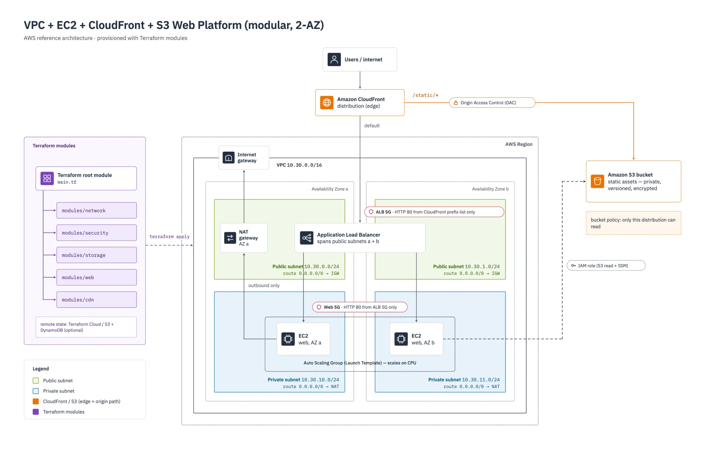

# VPC + EC2 + CloudFront + S3 web platform (Terraform, modular)

A full web platform on AWS: a **CloudFront** CDN in front of an **EC2** web tier (Auto Scaling Group behind an **ALB**, in private subnets across two AZs) for dynamic traffic, and a private **S3** bucket for static assets served through CloudFront with **Origin Access Control**. Deep VPC networking: public/private subnets, AZs, route tables, NAT, and chained security groups.



```
Users → CloudFront ──default──▶ ALB (public subnets) → EC2 Auto Scaling Group (private subnets)
                   └─/static/*─▶ S3 bucket (private, via Origin Access Control)
EC2 → S3 (IAM role)         EC2 outbound → NAT Gateway → Internet Gateway
```

## Structure
```
vpc-ec2-cloudfront-s3/
├── versions.tf        # Terraform + provider versions
├── providers.tf       # AWS provider + default tags
├── variables.tf       # inputs
├── main.tf            # calls the five modules
├── outputs.tf         # CloudFront URL, ALB DNS, bucket name
├── terraform.tfvars   # values
└── modules/
    ├── network/       # VPC, public/private subnets, AZs, IGW, NAT, route tables
    ├── security/      # ALB SG (from CloudFront prefix list) + web SG
    ├── storage/       # private S3 bucket (versioned, encrypted)
    ├── web/           # EC2 launch template, ALB, target group, listener, ASG, IAM
    └── cdn/           # CloudFront distribution, Origin Access Control, bucket policy
```

---

## Build order — follow these steps

### Step 0 — Choose your variables
Open `variables.tf` / `terraform.tfvars` and set:
1. `region`, `project`, `environment`
2. `vpc_cidr` and `az_count` (2)
3. `instance_type`, `min_size`, `max_size`, `desired_capacity`, `cpu_target`

Docs: [input variables](https://developer.hashicorp.com/terraform/language/values/variables) · [AWS provider](https://registry.terraform.io/providers/hashicorp/aws/latest/docs)

### Step 1 — Network (`modules/network`)
1. **VPC** → [aws_vpc](https://registry.terraform.io/providers/hashicorp/aws/latest/docs/resources/vpc)
2. **Internet gateway** → [aws_internet_gateway](https://registry.terraform.io/providers/hashicorp/aws/latest/docs/resources/internet_gateway)
3. **Public subnets** (one per AZ) → [aws_subnet](https://registry.terraform.io/providers/hashicorp/aws/latest/docs/resources/subnet) · [cidrsubnet](https://developer.hashicorp.com/terraform/language/functions/cidrsubnet)
4. **Private subnets** (one per AZ) → [aws_subnet](https://registry.terraform.io/providers/hashicorp/aws/latest/docs/resources/subnet)
5. **Elastic IP** for NAT → [aws_eip](https://registry.terraform.io/providers/hashicorp/aws/latest/docs/resources/eip)
6. **NAT gateway** → [aws_nat_gateway](https://registry.terraform.io/providers/hashicorp/aws/latest/docs/resources/nat_gateway)
7. **Public + private route tables** → [aws_route_table](https://registry.terraform.io/providers/hashicorp/aws/latest/docs/resources/route_table)
8. **Route table associations** → [aws_route_table_association](https://registry.terraform.io/providers/hashicorp/aws/latest/docs/resources/route_table_association)
9. Expose `vpc_id`, `public_subnet_ids`, `private_subnet_ids` → [outputs](https://developer.hashicorp.com/terraform/language/values/outputs)

### Step 2 — Security (`modules/security`)
1. Look up the **CloudFront managed prefix list** → [aws_ec2_managed_prefix_list](https://registry.terraform.io/providers/hashicorp/aws/latest/docs/data-sources/ec2_managed_prefix_list)
2. **ALB security group** — inbound 80 from that prefix list only → [aws_security_group](https://registry.terraform.io/providers/hashicorp/aws/latest/docs/resources/security_group)
3. **Web security group** — inbound 80 from the ALB SG only
4. Expose `alb_sg_id`, `web_sg_id`

### Step 3 — Storage (`modules/storage`)
1. **S3 bucket** (`bucket_prefix`) → [aws_s3_bucket](https://registry.terraform.io/providers/hashicorp/aws/latest/docs/resources/s3_bucket)
2. **Versioning** → [aws_s3_bucket_versioning](https://registry.terraform.io/providers/hashicorp/aws/latest/docs/resources/s3_bucket_versioning)
3. **Encryption** → [aws_s3_bucket_server_side_encryption_configuration](https://registry.terraform.io/providers/hashicorp/aws/latest/docs/resources/s3_bucket_server_side_encryption_configuration)
4. **Public access block** (keep it private) → [aws_s3_bucket_public_access_block](https://registry.terraform.io/providers/hashicorp/aws/latest/docs/resources/s3_bucket_public_access_block)
5. Expose `bucket_id`, `bucket_name`, `bucket_arn`, `bucket_regional_domain_name`

### Step 4 — Web / EC2 (`modules/web`)
1. Look up the latest **Amazon Linux 2023 AMI** → [aws_ami](https://registry.terraform.io/providers/hashicorp/aws/latest/docs/data-sources/ami)
2. Build the **IAM role** (trust EC2) + attach SSM + inline S3 read → [aws_iam_policy_document](https://registry.terraform.io/providers/hashicorp/aws/latest/docs/data-sources/iam_policy_document) · [aws_iam_role](https://registry.terraform.io/providers/hashicorp/aws/latest/docs/resources/iam_role) · [aws_iam_role_policy_attachment](https://registry.terraform.io/providers/hashicorp/aws/latest/docs/resources/iam_role_policy_attachment) · [aws_iam_role_policy](https://registry.terraform.io/providers/hashicorp/aws/latest/docs/resources/iam_role_policy)
3. **Instance profile** → [aws_iam_instance_profile](https://registry.terraform.io/providers/hashicorp/aws/latest/docs/resources/iam_instance_profile)
4. **Launch template** (AMI, type, web SG, instance profile, user-data) → [aws_launch_template](https://registry.terraform.io/providers/hashicorp/aws/latest/docs/resources/launch_template) · [base64encode](https://developer.hashicorp.com/terraform/language/functions/base64encode)
5. **ALB** in public subnets → [aws_lb](https://registry.terraform.io/providers/hashicorp/aws/latest/docs/resources/lb)
6. **Target group** + **listener** → [aws_lb_target_group](https://registry.terraform.io/providers/hashicorp/aws/latest/docs/resources/lb_target_group) · [aws_lb_listener](https://registry.terraform.io/providers/hashicorp/aws/latest/docs/resources/lb_listener)
7. **Auto Scaling Group** in private subnets → [aws_autoscaling_group](https://registry.terraform.io/providers/hashicorp/aws/latest/docs/resources/autoscaling_group)
8. **CPU auto-scaling policy** → [aws_autoscaling_policy](https://registry.terraform.io/providers/hashicorp/aws/latest/docs/resources/autoscaling_policy)
9. Expose `alb_dns_name`

### Step 5 — CDN (`modules/cdn`)
1. **Origin Access Control** (so CloudFront can read the private bucket) → [aws_cloudfront_origin_access_control](https://registry.terraform.io/providers/hashicorp/aws/latest/docs/resources/cloudfront_origin_access_control)
2. **CloudFront distribution** with two origins (ALB default, S3 for `/static/*`) → [aws_cloudfront_distribution](https://registry.terraform.io/providers/hashicorp/aws/latest/docs/resources/cloudfront_distribution)
3. **S3 bucket policy** allowing the distribution to read objects → [aws_s3_bucket_policy](https://registry.terraform.io/providers/hashicorp/aws/latest/docs/resources/s3_bucket_policy) · [aws_iam_policy_document](https://registry.terraform.io/providers/hashicorp/aws/latest/docs/data-sources/iam_policy_document)
4. Expose `distribution_domain_name`, `distribution_arn`

### Step 6 — Wire the root
1. AZ lookup → [aws_availability_zones](https://registry.terraform.io/providers/hashicorp/aws/latest/docs/data-sources/availability_zones)
2. Call the five modules in `main.tf` → [module block](https://developer.hashicorp.com/terraform/language/modules/syntax) (order: network → security → storage → web → cdn)
3. Add root `outputs.tf`

---

## Run
```bash
terraform init
terraform fmt -recursive
terraform validate
terraform plan
terraform apply
```
Open the `cloudfront_url` output in a browser (CloudFront takes a few minutes to deploy). Upload a file under a `static/` prefix in the bucket to see the S3 path. Tear down with `terraform destroy`.

## Remote state (optional)
Add a `cloud {}` block for Terraform Cloud, or a `backend "s3"` block (bucket + DynamoDB lock table), then `terraform init` to migrate.

## Notes
- Needs AWS credentials (`aws configure`) and Terraform >= 1.6.
- The ALB only accepts traffic from CloudFront (via the managed prefix list), and the S3 bucket stays private (read only by CloudFront via OAC).
- The **NAT gateway, ALB, EC2, and CloudFront** cost money — run `terraform destroy` when done.
